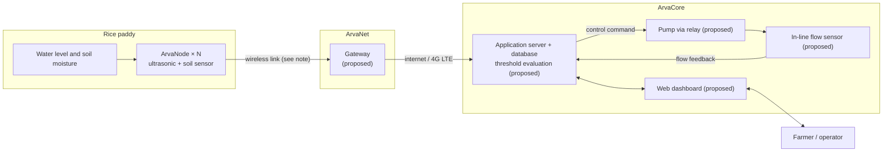

# ArvaCore

**IoT-based irrigation monitoring and automated water management for rice cultivation**

ArvaCore is an undergraduate Computer Engineering research project at the Polytechnic University of the Philippines (PUP), Sta. Mesa, Manila. It proposes a system that measures paddy water level and soil moisture in the field, sends the readings to a remote server and web dashboard, and uses configured thresholds to support irrigation pump control.

This repository contains the **project whitepaper website**: a Next.js site that explains the research, the system architecture, the evaluation approach, and the funding needed for prototype deployment. It does **not** contain device firmware, a backend server, or a working dashboard.

> **Arva**, derived from the Latin word *arvum*, meaning "fertile," "cultivated field," or "arable land".

---

## Contents

1. [The problem](#1-the-problem)
2. [Research context](#2-research-context)
3. [The ArvaCore system family](#3-the-arvacore-system-family)
4. [System architecture](#4-system-architecture)
5. [What this repository implements](#5-what-this-repository-implements)
6. [Technology stack](#6-technology-stack)
7. [Repository structure](#7-repository-structure)
8. [Getting started](#8-getting-started)
9. [Hardware and preliminary budget](#9-hardware-and-preliminary-budget)
10. [Methodology and evaluation](#10-methodology-and-evaluation)
11. [Status and limitations](#11-status-and-limitations)
12. [OpenSpec workflow](#12-openspec-workflow)
13. [Contributing](#13-contributing)
14. [Safety considerations](#14-safety-considerations)
15. [Team](#15-team)
16. [License and citation](#16-license-and-citation)

---

## 1. The problem

Irrigated rice farming needs the right amount of water in the field. Too little stresses the crop, and too much or poorly timed irrigation wastes water and pumping effort. In Barangay Silang, Lopez, Quezon, farmers decide when to irrigate mainly by walking the fields and looking. They also face rising equipment costs and coordination problems on shared irrigation systems ([arvacore_whitepaper.md](arvacore_whitepaper.md), §1, §5).

ArvaCore aims to replace part of that manual observation with continuous sensor readings that farmers can check remotely. The readings would also drive threshold-based pump control. The thesis frames the system as a **complement** to existing irrigation practice, not a replacement for existing infrastructure.

## 2. Research context

| Item | Detail |
| :--- | :--- |
| Formal title | *ARVACORE: An IoT-Based Irrigation Monitoring and Automated Water Management System for Rice Cultivation* |
| Document type | Thesis **proposal** (Chapters 1–3, References, Appendix A), 60 pages, September 2026 |
| Institution | Polytechnic University of the Philippines, Sta. Mesa, Manila — BS Computer Engineering |
| Planned deployment site | Barangay Silang, Lopez, Quezon Province, Philippines |
| Source files | [`ARVACORE.pdf`](ARVACORE.pdf) (authoritative), [`arvacore_whitepaper.md`](arvacore_whitepaper.md) (summary) |

**General objective (from the thesis):** develop and evaluate ArvaCore, then assess its technical performance and its acceptability to rice farmers and agricultural practitioners in Lopez, Quezon.

**Specific objectives:** identify current irrigation practices and challenges; document development using the prototyping method; evaluate the hardware (water-level and soil-moisture accuracy, irrigation activation/deactivation accuracy, response time, water-consumption monitoring); and measure user acceptability (functionality, reliability, usability, efficiency).

> [!NOTE]
> **Scope change versus the thesis text.** The thesis proposal describes ArvaCore as supporting *Alternate Wetting and Drying (AWD)*. The project team has since dropped AWD as the operating framework, so the website now describes the system as general sensor-informed irrigation monitoring and water management. The formal thesis title never mentioned AWD and is unchanged. The PDF itself was not edited and still contains the AWD wording.

## 3. The ArvaCore system family

The names designate the four integrated subsystems of the overall architecture:

| Subsystem | Role | Description & Hardware Components |
| :--- | :--- | :--- |
| **ArvaCore** | Automated Irrigation Decision &amp; Pump Controller | Centralized closed-loop decision engine and pump relay controller with in-line flow verification. Compares sensor readings against configured water thresholds to actuate or shut down the irrigation pump. |
| **ArvaNode** | Distributed Field Hydrology Monitoring Nodes | Modular solar-powered field units measuring ponded water level (ultrasonic ToF inside a perforated stilling well) and root-zone soil moisture (-15 cm capacitive probe). Scalable node count across paddy zones (ESP MCU, 18650 battery, solar charging). |
| **ArvaNet** | Long-Range Wireless Internet Gateway &amp; Wi-Fi Base | On-site radio receiver station, agricultural Wi-Fi access hub, and cellular WAN bridge. Receives wireless telemetry packets from ArvaNodes and relays authenticated data to cloud servers (ESP32, 900 MHz LoRa, Air780E 4G LTE Cat-1). |
| **ArvaLink** | Farmer Web Telemetry Dashboard &amp; Mobile App | Farmer-facing digital monitoring platform. Provides real-time field depth gauges, historical soil drying curves, automated irrigation alerts, remote pump override switches, and multi-node agricultural analytics. |

## 4. System architecture

The flow below follows thesis Figure 3. Parts marked *(proposed)* are designed but do not exist yet.



**How data moves:**

1. Each ArvaNode reads water depth (ultrasonic time-of-flight inside a perforated stilling well) and root-zone soil moisture.
2. Readings go wirelessly to the ArvaNet gateway, which forwards them to the application server.
3. The server stores the readings and shows them on the dashboard.
4. When the water level falls below a configured threshold, the server tells the pump to turn on. When the target level is reached, it tells the pump to turn off (thesis process flow, Figure 2).
5. The flow sensor reports whether water is actually moving, so a pump that is switched on but delivers no water (or flow while the pump is off) can be flagged.

> [!WARNING]
> **Unresolved hardware discrepancy.** The thesis describes the nodes as ESP32 boards with built-in Wi-Fi talking to the gateway. The current bill of materials lists **ESP8266** boards for the nodes and a **sub-GHz LoRa transceiver** plus **4G LTE** module for the gateway. The node-to-gateway link (Wi-Fi or LoRa) has not been confirmed, so the diagram leaves it unlabeled.

## 5. What this repository implements

**Implemented (website only):**

- A single-page whitepaper with eight sections: overview, agricultural context, field nodes, system architecture, decision logic, evaluation approach, expected benefits, and deployment funding.
- An interactive SVG architecture diagram with component inspection and a separate card layout for mobile.
- An interactive paddy cross-section and a water-level threshold simulator linked to the process flowchart. Both are **client-side simulations**, not live data.
- A lightbox for diagrams (zoom, drag to pan, reset, Escape to close).
- A sticky reading header with scroll progress and a table-of-contents drawer.
- An itemized preliminary budget that computes its subtotals and totals from the line-item data.
- Support for `prefers-reduced-motion`.

**Designed in the thesis but not in this repository:** node and gateway firmware, the application server and database, the farmer-facing dashboard, and pump/relay control.

**Planned:** prototype assembly, bench testing, field deployment, and user evaluation in Barangay Silang.

## 6. Technology stack

**Website (verified from [`package.json`](package.json)):**

| Layer | Technology |
| :--- | :--- |
| Framework | Next.js 16.4.0 (App Router, Turbopack) |
| UI | React 19.3.0 |
| Language | TypeScript 5 |
| Styling | Tailwind CSS v4 via `@tailwindcss/turbopack` |
| Diagrams | Hand-written inline SVG React components (no charting or animation libraries) |
| Linting | ESLint 9 with `eslint-config-next` |

**Research system (from the thesis and bill of materials; not in this repo):** ESP8266/ESP32 microcontrollers, HC-SR04 ultrasonic sensors, soil-moisture sensors, LoRa (E32-900T20D) and 4G LTE (Air780E) communications, solar and 18650 lithium power, plus a server, database, and web dashboard whose implementation technologies have not yet been chosen.

## 7. Repository structure

```text
arvacore-whitepaper/
├── app/
│   ├── layout.tsx            # Metadata, fonts, root layout
│   ├── page.tsx              # Composes the eight sections
│   └── globals.css           # Design tokens, reduced-motion rules
├── components/
│   ├── hero/                 # AcademicHero (title, team, CTAs)
│   ├── navigation/           # ReadingHeader, TableOfContentsDrawer
│   ├── sections/             # One file per page section
│   ├── exhibits/             # SVG diagrams and simulators
│   └── ui/                   # FigureFrame, DiagramLightbox, TelemetryBadge, CitationCard
├── lib/
│   ├── whitepaper-data.ts    # All page content, architecture data, budget line items
│   ├── bibliography-data.ts  # Reference list (currently not rendered)
│   └── types.ts              # Shared TypeScript types
├── public/ARVACORE.pdf       # Thesis copy (not linked from the site)
├── docs/phases/              # Phase completion records
├── openspec/
│   ├── specs/                # Current approved specifications
│   └── changes/archive/      # Completed, archived changes
├── ARVACORE.pdf              # Authoritative thesis proposal
└── arvacore_whitepaper.md    # Markdown summary of the thesis
```

## 8. Getting started

**Prerequisites:** Node.js 20 or later (developed on 22.16) and npm. The repo includes `package-lock.json`.

```bash
npm install
npm run dev      # http://localhost:3000
```

| Script | Purpose |
| :--- | :--- |
| `npm run dev` | Development server |
| `npm run build` | Production build |
| `npm run start` | Serve the production build |
| `npm run lint` | ESLint |

No environment variables or external services are needed. There is no automated test suite yet.

> [!IMPORTANT]
> This repository cannot be used to build the physical prototype. It has no wiring diagrams, firmware, or deployment instructions.

## 9. Hardware and preliminary budget

The website's funding section is built from the line items in [`lib/whitepaper-data.ts`](lib/whitepaper-data.ts) (`BUDGET_ITEMS`). Subtotals, the total, and the headroom are all computed from those items.

| Group | Subtotal | Price basis |
| :--- | ---: | :--- |
| ArvaNode (one node) | ₱1,016 | Preliminary prices supplied by the team |
| ArvaNet (gateway) | ₱3,410 | Preliminary prices supplied by the team |
| ArvaCore control | ₱1,529 | ₱299 ESP32 supplied; relay ₱380 and flow sensor ₱850 estimated |
| Assembly & deployment | ₱10,250 | Estimates: enclosures/stilling wells, mounting, connectivity/cloud, consumables, transport and field testing |
| Contingency | ₱1,795 | Estimate |
| **Total estimated expenses** | **₱18,000** | |
| **Funding target** | **₱25,000** | |
| **Budget headroom** | **₱7,000** | Target minus estimated expenses |

- Nothing in this table has been purchased. "Supplied" means the team supplied the *price*, not that the item was bought or donated.
- Headroom is not money that has been raised. It absorbs price changes once real supplier quotations replace the estimates.
- The ArvaNode subtotal covers **one** node. Adding nodes increases cost by about ₱1,016 each, plus their share of enclosure and mounting costs.
- No funds have been received, no sponsors are confirmed, and no donation or payment channel exists yet.

## 10. Methodology and evaluation

The thesis uses a **quantitative, descriptive-developmental design** with prototyping (Input → Process → Output) and three instruments:

1. **Prototype trials:** repeated trials comparing sensor readings against manual and calibrated references, and measuring irrigation activation/deactivation accuracy, response time, and flow-measurement error.
2. **Problem validation report:** a checklist completed with a farm owner in Barangay Silang about current practices and challenges.
3. **Acceptability survey:** based on the Technology Acceptance Model (Davis, 1989) and covering functionality, reliability, usability, and efficiency.

The thesis sets **target benchmarks** for the trials: within ±5% sensor error, at least 95% activation/deactivation accuracy over 20 trials, response within 30 seconds, and low MAPE for flow measurement. These are **goals to be validated, not results**.

| Stage | Status |
| :--- | :--- |
| Methodology | Defined in the thesis proposal |
| Bench testing | Not yet performed |
| Field testing | Not yet performed |
| User survey | Not yet conducted |
| Measured results | None |

## 11. Status and limitations

- The source document is a proposal, so there are no experimental results.
- Firmware, server, dashboard, and actuation do not exist yet.
- The node microcontroller (ESP8266 vs. ESP32) and the node-to-gateway radio (Wi-Fi vs. LoRa) need to be confirmed (see §4).
- Most deployment costs are planning estimates that still need quotations.
- The thesis PDF still uses AWD framing, while the website no longer does (see §2).
- Diagram interactions and the simulator are illustrative and are not connected to hardware.

## 12. OpenSpec workflow

Website changes are tracked with [OpenSpec](https://github.com/Fission-AI/OpenSpec) (CLI v1.6, `spec-driven` schema; see [`openspec/config.yaml`](openspec/config.yaml)).

- Current requirements: [`openspec/specs/`](openspec/specs/)
- Completed changes (proposal, design, tasks): [`openspec/changes/archive/`](openspec/changes/archive/)
- Phase 1 record: [`docs/phases/phase-1-completion.md`](docs/phases/phase-1-completion.md)

```bash
openspec list                     # active changes
openspec status --change <name>   # artifact status for a change
openspec new change <name>        # start a change
openspec archive <name>           # archive a completed change and merge its specs
```

## 13. Contributing

1. Read the relevant spec in `openspec/specs/` before changing behavior.
2. For anything beyond a trivial fix, open an OpenSpec change (proposal, spec deltas, tasks).
3. Keep content in `lib/whitepaper-data.ts` rather than hard-coding it in components.
4. Run `npm run lint` and `npm run build` before submitting.
5. Every research or hardware claim must trace back to the thesis or the bill of materials. Never present targets or estimates as results.

## 14. Safety considerations

- **Mains and pump power:** never drive a pump directly from a microcontroller. Use a rated, isolated relay or contactor, proper fusing or breakers, and grounding, and have the wiring reviewed by a qualified person.
- **Test control logic first:** validate threshold logic with simulated inputs before connecting any physical pump.
- **Lithium cells:** 18650 packs need protection and charge-control circuits (already in the BOM). Shade and ventilate enclosures in tropical heat.
- **Enclosures:** paddy conditions are wet and muddy, so use sealed (IP65 or better) enclosures and cable glands.
- **Radio compliance:** confirm that 900 MHz LoRa and LTE equipment is permitted and correctly configured for use in the Philippines before deployment.

## 15. Team

Research team as presented on the website:

- **Gladwin Ferdz I. Del Rosario** — Project Lead & System Architect
- **Jenice Nicole C. Ramirez** — Project Manager & Research Coordinator (Paper, Data Survey Executions)
- **Pranz Gabrielle N. Capucion** — Hardware Architecture & Embedded Sensing

Public contact details have not been published yet. To ask about support, please reach the team through the repository owner.

## 16. License and citation

**No license has been specified.** All rights are reserved by the authors until a license is added.

Suggested citation (the work is an unpublished thesis proposal, so there is no DOI or permanent URL):

> Del Rosario, G. F. I., Ramirez, J. N. C., & Capucion, P. G. N. (2026). *ARVACORE: An IoT-based irrigation monitoring and automated water management system for rice cultivation* [Unpublished undergraduate thesis proposal]. Polytechnic University of the Philippines, Sta. Mesa, Manila.

> [!NOTE]
> The author order above follows the website's presentation. Confirm it against the PDF title page before citing formally.
